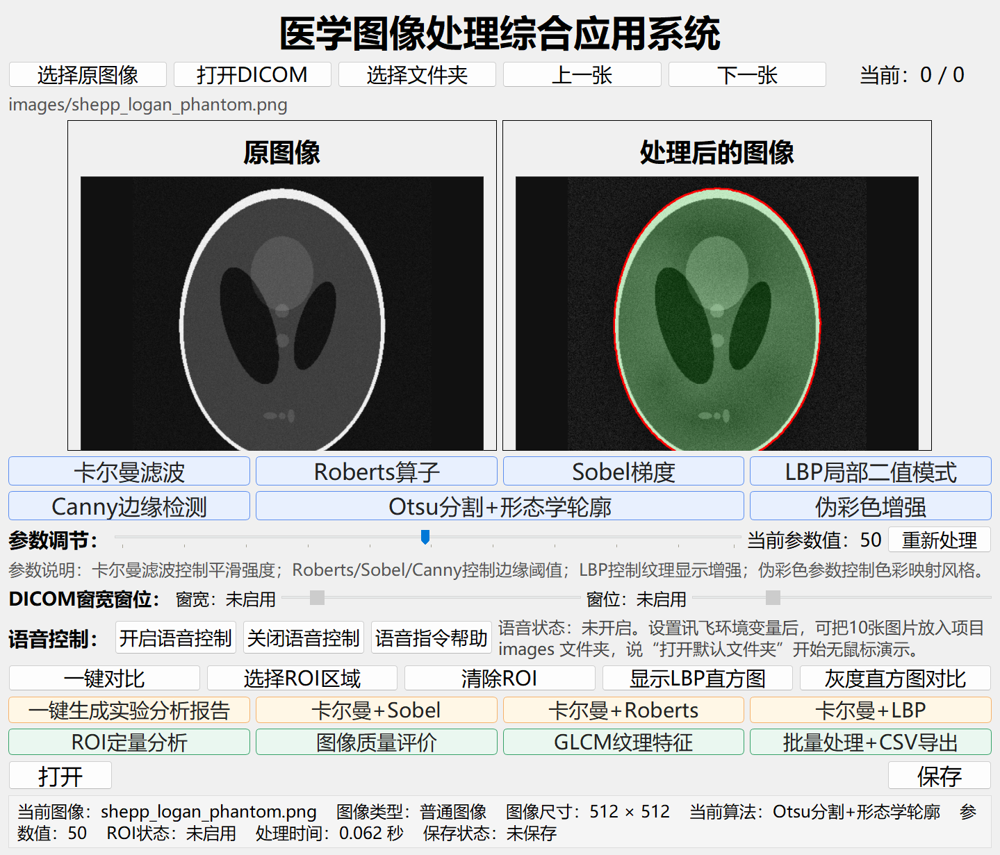
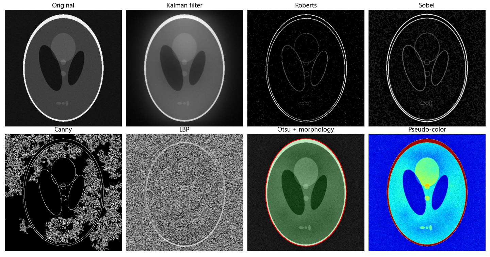
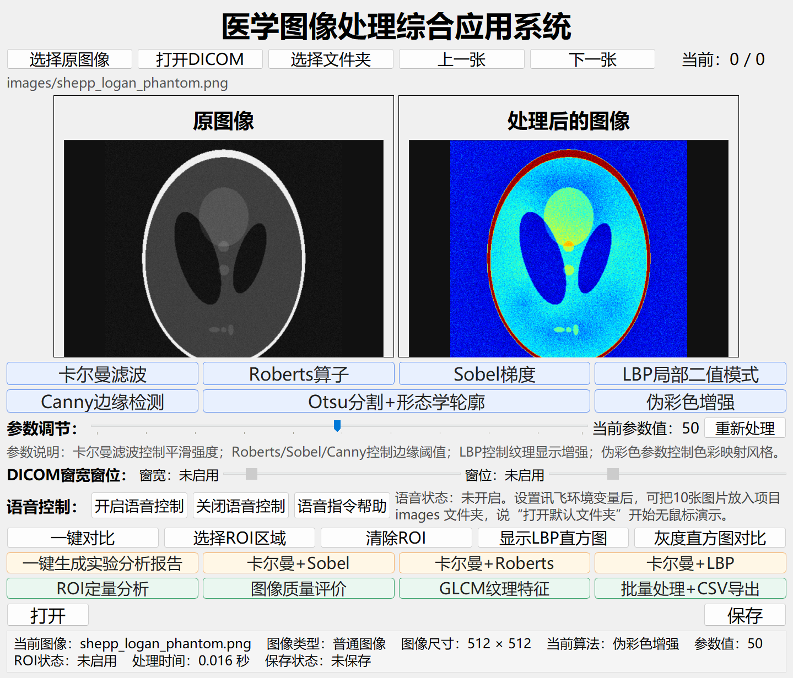

# Medical Image Processing Workbench

**English** | [简体中文](README.zh-CN.md)


A desktop workbench for processing and analysing medical images, built with PyQt5 and OpenCV. It opens ordinary images and DICOM studies and lets you window them. It applies classical enhancement, edge, texture and segmentation algorithms with live parameter sliders, and it measures the results quantitatively, either on the whole image or on a selected ROI. It can also be driven hands-free with Chinese voice commands through the iFlytek speech API.



## Features

| Area | What it does |
|---|---|
| **Input** | Single image, folder browsing (prev / next), **DICOM** (`.dcm`) with window width / level sliders, Unicode-safe paths |
| **Denoising** | 2-D **Kalman filter**: forward-backward 1-D Kalman passes along rows and columns, fused with the input and finished with a light bilateral filter |
| **Edges** | **Roberts**, **Sobel**, **Canny**, with percentile-based adaptive thresholds |
| **Texture** | 8-neighbour **LBP** with histogram and statistics; **GLCM** features (contrast, homogeneity, energy, correlation, entropy) implemented in NumPy |
| **Segmentation** | **Otsu** threshold, then morphological opening / closing, with contours overlaid |
| **Enhancement** | **Pseudo-colour** mapping; CLAHE pre-enhancement before the edge and texture operators |
| **Pipelines** | Kalman + Sobel / Roberts / LBP |
| **ROI** | Drag a region to process only that area; quantitative report covering grey-level stats, Laplacian sharpness, entropy, edge ratio and GLCM |
| **Evaluation** | Before / after grey-level histograms, image-quality comparison, one-click analysis report (exportable as `.txt`) |
| **Batch** | Runs every algorithm over a folder and exports the images plus a **CSV** metrics table |
| **Voice control** *(optional)* | iFlytek streaming speech-to-text over WebSocket; fuzzy-matched Chinese commands for every button |



## Quick start

```bash
pip install -r requirements.txt
python medical_image_system.py
```

A synthetic Shepp-Logan phantom is included in [`images/`](images/) so you can try every algorithm straight away. Click **选择原图像** (Open image), pick a file and then click any algorithm button.

### Voice control (optional)

Create an app on the [iFlytek open platform](https://www.xfyun.cn/) with *Speech Dictation* enabled. Then set your credentials as environment variables:

```bat
setx XFYUN_APPID "your-app-id"
setx XFYUN_API_KEY "your-api-key"
setx XFYUN_API_SECRET "your-api-secret"
```

Restart the terminal and click **开启语音控制** (Start voice control). Then try commands such as “打开默认文件夹” (load `images/`), “Sobel”, “下一张” (next image), “一键对比” (compare all) or “帮助” (help). Credentials are read only from the environment. Nothing is stored in the code.



## Code structure

`medical_image_system.py` is a single, self-contained module:

| Section | Contents |
|---|---|
| I/O helpers | Unicode-safe read and write, DICOM decoding with window centre / width, folder scanning |
| Algorithms | `kalman_filter_image`, `roberts_operator`, `sobel_gradient`, `canny_edge_detection`, `lbp_local_binary_pattern`, `otsu_morphology_contour`, `pseudo_color_enhancement` |
| Metrics | entropy, Laplacian-variance sharpness, edge ratio, quality metrics, `calculate_glcm_features` |
| Dialogs | zoom preview, side-by-side comparison, LBP histogram, histogram comparison, analysis report |
| `XfyunVoiceRecognitionWorker` | Background thread that signs the iFlytek request with HMAC-SHA256, streams microphone audio and emits recognised text through Qt signals |
| `MedicalImageProcessingSystem` | Main window, ROI selection, debounced live re-processing and the voice-command router |

## Notes

* The included image is a computer-generated phantom. No patient data is shipped. Remove patient identifiers before you open real DICOM files.
* All metrics are for comparing algorithms. They are **not** a basis for diagnosis.

## License

[MIT](LICENSE)
