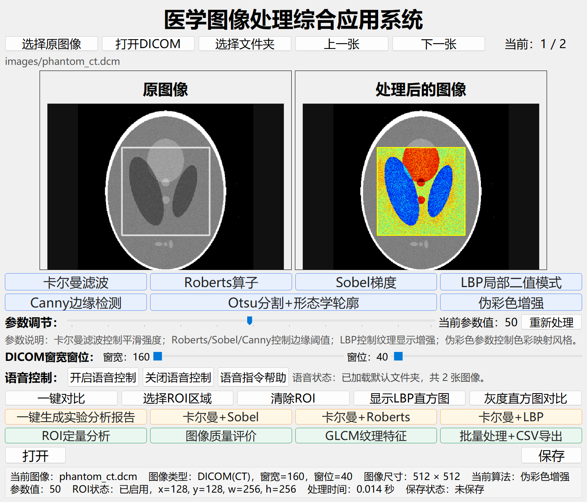
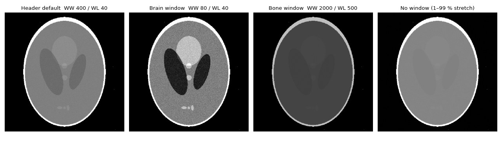
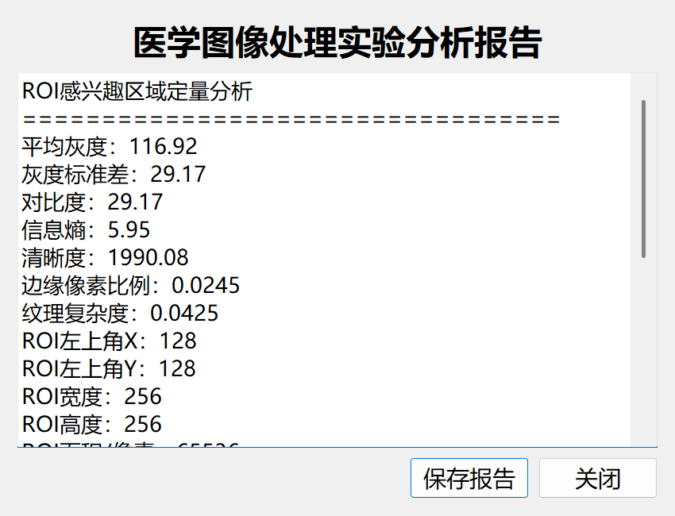
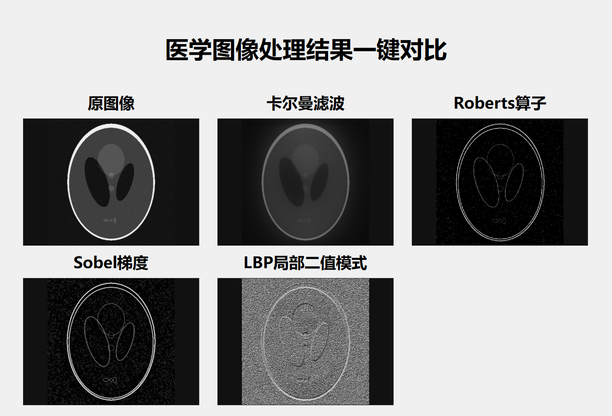
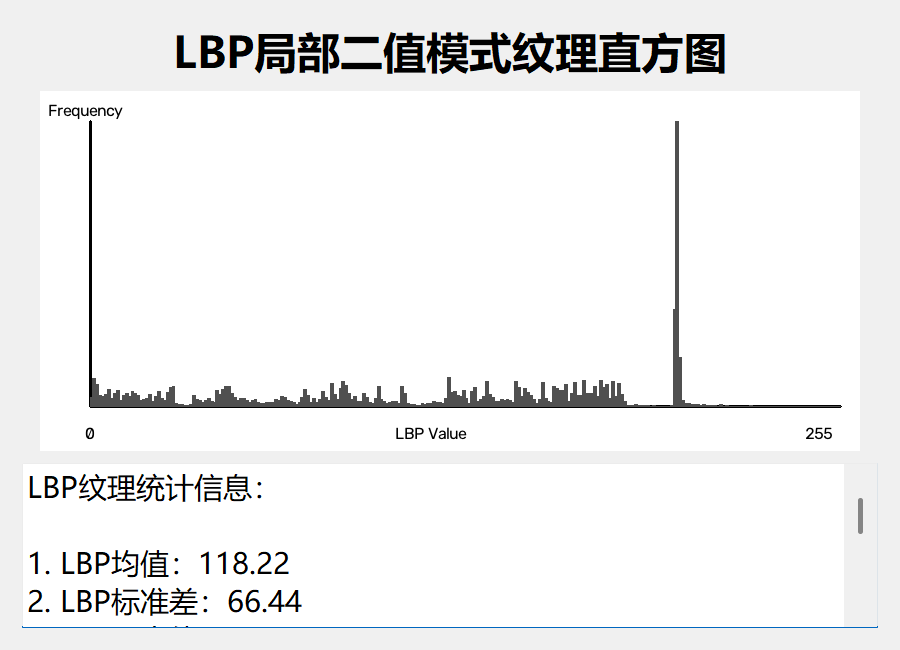
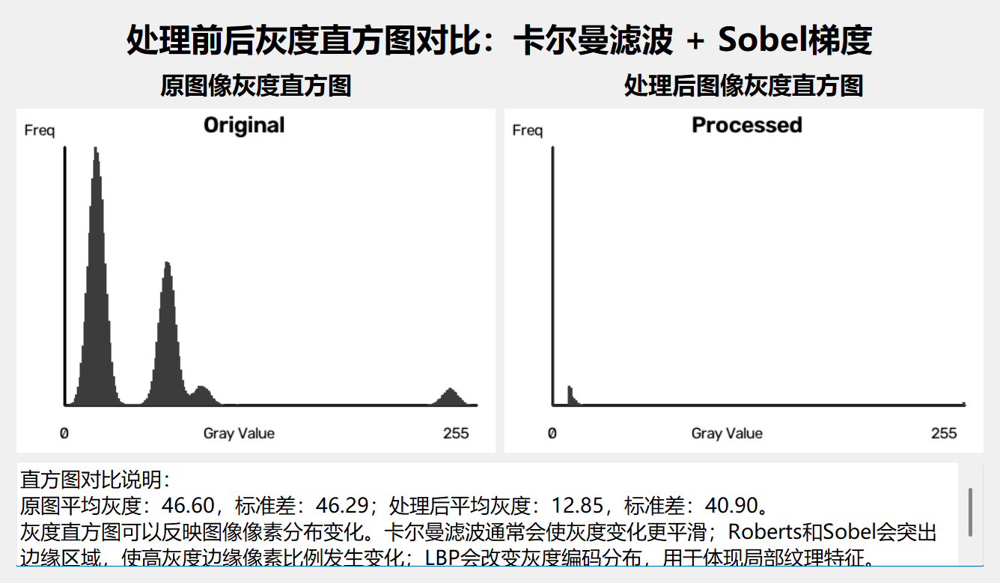
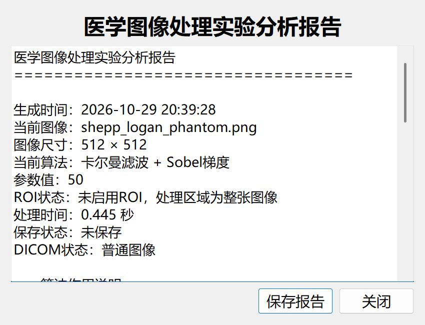
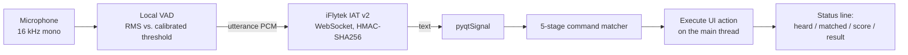

# Medical Image Processing Workbench

**English** | [简体中文](README.zh-CN.md)


A desktop workbench for processing and analysing medical images, built with PyQt5 and OpenCV. It reads ordinary images and **DICOM** studies, with interactive window width / level. It runs **10 processing pipelines** for denoising, edge detection, texture, segmentation and colour mapping, and each one re-renders live as you drag its parameter slider. Any operation can be limited to a **region of interest**. The workbench measures image quality and **GLCM** texture, writes a structured analysis report, batch-processes a whole folder into images plus a **CSV** table, and can be operated hands-free with **Chinese voice commands**. That last feature uses local voice-activity detection and the iFlytek streaming speech API.


## Highlights

* **Medical-image I/O.** DICOM pixels are rescaled to Hounsfield units through `RescaleSlope` / `RescaleIntercept`, then windowed with the header's WW / WL. Two sliders change the window in real time. Only technical tags are used, never patient fields.
* **Algorithms tuned for medical images.** Every operator is preceded by CLAHE contrast enhancement. Edge thresholds adapt to percentiles of each image's own gradient distribution, so one slider works across X-ray, CT, MRI and ultrasound.
* **2-D Kalman denoiser written from scratch.** A forward-backward 1-D Kalman recursion runs along rows and then columns. The result is blended with the input and finished with an edge-preserving bilateral filter.
* **Texture in two complementary forms.** An 8-neighbour LBP is vectorised in NumPy. A GLCM covering 4 directions and 32 grey levels is also written in NumPy, so scikit-image is not needed.
* **ROI-aware everything.** Processing, comparison, histograms, quality metrics and GLCM all apply only to the selected region when one is set.
* **Reports and batch export.** A one-click analysis report can be saved as `.txt`. Batch mode writes 7 algorithms × N images plus a UTF-8 CSV that opens directly in Excel.
* **Voice control that tolerates recognition errors.** Speech is detected locally with a VAD and recognised by iFlytek. The text then goes through a 5-stage command matcher: numeric parameters, homophone rules, substring match, `difflib` fuzzy match and phonetic-cue fallback. The matcher covers 34 commands.
* **A responsive Qt UI.** Slider re-processing is debounced, the image panes have a fixed size, file I/O is Unicode-safe, and the voice thread talks to the UI only through Qt signals.

## Contents

1. [Quick start](#quick-start)
2. [Interface tour](#interface-tour)
3. [Image input and DICOM](#image-input-and-dicom)
4. [Processing algorithms](#processing-algorithms)
5. [Region of interest](#region-of-interest)
6. [Quantitative analysis](#quantitative-analysis)
7. [Visual comparison tools](#visual-comparison-tools)
8. [Automatic analysis report](#automatic-analysis-report)
9. [Batch processing and CSV export](#batch-processing-and-csv-export)
10. [Voice control](#voice-control)
11. [Engineering notes](#engineering-notes)
12. [Performance](#performance)
13. [Code structure](#code-structure)

## Quick start

```bash
git clone https://github.com/Brian61-liu/medical-image-processing-system.git
cd medical-image-processing-system
pip install -r requirements.txt
python medical_image_system.py
```

Two synthetic samples are included in [`images/`](images/):

| File | Description |
|---|---|
| `shepp_logan_phantom.png` | Shepp-Logan head phantom, 512 × 512, with mild Gaussian noise |
| `phantom_ct.dcm` | The same phantom as a 16-bit CT DICOM. Values are in HU: air −1000, CSF 10, brain 40, bone 1000. `RescaleIntercept` is −1024 and the default window is 400 / 40 |

Click **选择文件夹** (Open folder) and select `images/`. Alternatively, start voice control and say “打开默认文件夹”. Use **上一张 / 下一张** to switch between the two samples, then click any algorithm button.

`pydicom` is only needed for `.dcm` files. `websocket-client` and `sounddevice` are only needed for voice control. If any of them is missing, the rest of the application still works.

## Interface tour



| Row | Controls |
|---|---|
| File bar | Open image · Open DICOM · Open folder · Previous / Next · counter `n / N` · current path |
| Image panes | Original image on the left, with the ROI box drawn. Processed result on the right. Both panes have a fixed size |
| Algorithms | Kalman · Roberts · Sobel · LBP · Canny · Otsu + morphology · Pseudo-colour |
| Parameter | One 1–100 slider shared by all algorithms. The result refreshes 120 ms after you stop dragging. A **Re-process** button is also provided |
| DICOM | Window width and window level sliders. They are enabled only for DICOM files |
| Voice | Start / stop voice control, command help, live status line |
| Tools | Compare all · Select ROI · Clear ROI · LBP histogram · Histogram comparison |
| Pipelines | Analysis report · Kalman + Sobel · Kalman + Roberts · Kalman + LBP |
| Analysis | ROI analysis · Quality evaluation · GLCM features · Batch + CSV export |
| Footer | Open large preview · Save result · info bar showing file, type, size, algorithm, parameter, ROI, processing time and save status |

## Image input and DICOM

* **Formats:** `.png .jpg .jpeg .bmp .tif .tiff .dcm`. Folders are scanned for all of these formats and sorted. Navigation wraps around at both ends.
* **Unicode paths:** images are read with `np.fromfile` + `cv2.imdecode` and written with `cv2.imencode` + `tofile`. This avoids the `cv2.imread` failures that occur with non-ASCII Windows paths.
* **DICOM pipeline:**
  1. `pydicom.dcmread` reads the file, then the pixel array is converted to float.
  2. Modality values are computed as `raw × RescaleSlope + RescaleIntercept`, giving HU for CT.
  3. `WindowCenter` and `WindowWidth` are read from the header. Multi-value tags use their first value. If a tag is missing, the centre falls back to the median and the width to P99 − P1.
  4. Each value is mapped linearly to `[WL − WW/2, WL + WW/2] → [0, 255]` and clipped.
  5. The slider ranges are set from the image's own min / max values. Moving a slider re-windows the raw HU data and clears the stale result.
* **Privacy:** only Modality, Rows / Columns and PixelSpacing are read. Patient tags are never accessed or displayed.



## Processing algorithms


Every algorithm takes the grey image and the slider value `v ∈ [1, 100]`.

| Algorithm | Pipeline | What the slider controls |
|---|---|---|
| **Kalman filter** | P0.5–P99.5 stretch → forward + backward 1-D Kalman on every **row**, then every **column** → blend with input → bilateral filter (d = 5) | Smoothing strength: higher `v` gives a larger measurement noise R, a smaller process noise Q and a larger blend weight |
| **Roberts** | CLAHE (clip 1.8) → 3 × 3 median → 2 × 2 cross kernels `[[1,0],[0,-1]]`, `[[0,1],[-1,0]]` → magnitude → P2–P98.5 stretch → adaptive threshold → 2 × 2 opening | Threshold percentile, from P62 to P94 of the non-zero edge strengths |
| **Sobel** | CLAHE (2.0) → Gaussian 3 × 3, σ 0.8 → Sobel x / y (k = 3) → magnitude → P1–P99 stretch → adaptive threshold → 3 × 3 closing | Threshold percentile, from P58 to P92 |
| **Canny** | CLAHE → Gaussian 5 × 5, σ 1 → Canny with L2 gradient. Thresholds are set from the median `m`: `m(1 ± s)` | Band width `s = 0.45 + 0.85·v/100`, so higher values keep only strong edges |
| **LBP** | CLAHE (1.6) → 3 × 3 median → 8-neighbour code, clockwise bit order → histogram equalisation → fused with a 7 × 7 local standard-deviation map (0.78 / 0.22) | Blend weight between the raw and the equalised LBP code |
| **Otsu + morphology** | CLAHE → Gaussian 5 × 5 → Otsu threshold (inverted automatically when > 60 % of pixels are foreground) → elliptical opening, then closing → external contours (area ≥ 0.04 % of the image) → green mask at 22 % opacity + red outline | Kernel size 3 / 5 / 7 and number of closing iterations |
| **Pseudo-colour** | CLAHE (1.8) → OpenCV colour map | `v < 34` gives BONE, `v < 67` gives JET, otherwise HOT |
| **Kalman → Sobel / Roberts / LBP** | Kalman output is used as the input to the second operator | Applies to both stages |

**Kalman filter details.** Each pixel line is treated as a 1-D signal with a constant-state model:

```
predict:  x̂⁻ = x̂,           P⁻ = P + Q
update:   K  = P⁻ / (P⁻ + R)
          x̂  = x̂⁻ + K (z − x̂⁻),   P = (1 − K) P⁻
```

where `Q = 1e-5 + 2e-5·(101 − v)/100` and `R = 0.004 + 0.10·v/100`. The recursion runs forward and backward and the two passes are averaged, which removes the lag a one-way filter introduces. It is applied to rows and then to columns. The result is blended with the stretched input using `α = 0.45 + 0.45·v/100`, then a bilateral filter with `σ_color = 20 + 0.4v` is applied.

**Adaptive edge threshold.** Fixed thresholds behave very differently on a dark MRI and a bright X-ray. Here the threshold is a percentile of the image's own non-zero gradient magnitudes, and the slider selects that percentile. `THRESH_TOZERO` is used, so edges that survive keep their strength.

## Region of interest

* **Select ROI** opens an OpenCV window. Drag a rectangle, then press Enter or Space to confirm or Esc to cancel.
* **Centre ROI** sets the central 50 % × 50 % of the image without using the mouse. It is available as a voice command.
* When an ROI is set, the algorithm runs **only on the cropped region**. The result is pasted back into the grey image and outlined: white for grey output, yellow for colour output such as pseudo-colour or Otsu.
* The comparison dialog, the LBP histogram, quality evaluation and GLCM all use the ROI when one exists. **ROI analysis** reports the ROI geometry together with every metric below.



## Quantitative analysis

| Metric | Definition |
|---|---|
| Mean grey level | `mean(I)` |
| Standard deviation / contrast | `std(I)` |
| Entropy | Shannon entropy of the 256-bin histogram, `−Σ p log₂ p` |
| Sharpness | Variance of the Laplacian |
| Edge-pixel ratio | Fraction of pixels marked by `Canny(60, 160)` |
| Texture complexity | Mean of the 7 × 7 local standard deviation divided by 255 |

**GLCM:** grey levels are quantised to 32. Co-occurrences are counted at distance 1 in **4 directions (0°, 45°, 90°, 135°)**, accumulated symmetrically and normalised to `p(i, j)`. The vectorised computation uses `np.add.at`.

| Feature | Formula |
|---|---|
| Contrast | `Σ (i − j)² p` |
| Homogeneity | `Σ p / (1 + │i − j│)` |
| Energy | `Σ p²` |
| Correlation | `Σ (i − μᵢ)(j − μⱼ) p / (σᵢ σⱼ)` |
| Entropy | `−Σ p log₂ p` |

Sample output for the centre ROI of `phantom_ct.dcm` (WW 160 / WL 40):

```
ROI感兴趣区域定量分析                     ROI-GLCM纹理特征
平均灰度：116.92                          对比度 Contrast：3.55
灰度标准差：29.17                         同质性 Homogeneity：0.53
信息熵：5.95                              能量 Energy：0.02
清晰度：1990.08                           相关性 Correlation：0.87
边缘像素比例：0.0245                      熵 Entropy：6.22
纹理复杂度：0.0425                        灰度级 Levels：32
ROI面积/像素：65536
```

**Quality evaluation** computes the same metrics on the original image (or the ROI) and on the current result, side by side, with a short interpretation. For example, after pseudo-colour enhancement the standard deviation rises from 29.2 to 86.2 and the edge ratio from 0.025 to 0.105.

## Visual comparison tools

| Compare all | LBP histogram |
|---|---|
|  |  |

* **Compare all** shows the original next to Kalman, Roberts, Sobel and LBP results, all with the current parameter and ROI.
* **LBP histogram** plots the distribution of the 256 codes, drawn with OpenCV so matplotlib is not needed. It also reports the mean, standard deviation, range and texture complexity.
* **Histogram comparison** plots the 256-bin grey histograms before and after processing, with their means and standard deviations.
* **Large preview** shows the original and the result side by side in a resizable window.



## Automatic analysis report

**一键生成实验分析报告** (Generate analysis report) builds a structured text report from the current image and result. The report can be saved as UTF-8 `.txt`:

* **Header:** timestamp, file, size, algorithm, parameter, ROI, processing time, save status, and the DICOM window if the file is DICOM
* **1. Method:** an explanation of the selected pipeline
* **2 / 3. Statistics:** mean, std, min, max, entropy and Laplacian sharpness of the original and of the result
* **4. Findings:** conclusions that depend on the algorithm, such as edge ratio for edge operators, texture complexity for LBP, and smoothing for Kalman
* **5. Disclaimer**



## Batch processing and CSV export

**批量处理+CSV导出** (Batch + CSV export) runs every single-stage algorithm on every image in the loaded folder, using the current parameter value:

```
<export dir>/
├── kalman/        <name>_kalman.png
├── roberts/       <name>_roberts.png
├── sobel/         <name>_sobel.png
├── canny/         <name>_canny.png
├── lbp/           <name>_lbp.png
├── segment/       <name>_segment.png
├── pseudo_color/  <name>_pseudo_color.png
└── analysis_report.csv
```

* Images whose long side exceeds 1200 px are downscaled first to keep the batch fast.
* The CSV contains one row per image and algorithm. Columns: file, algorithm, status, original mean / std / entropy, processed mean / std / entropy / sharpness / edge ratio, output path.
* The CSV is written as `utf-8-sig`, so Excel shows the Chinese headers correctly. A failure on one image is recorded in its row and does not stop the batch. Progress appears in the info bar.

Excerpt from the bundled phantom:

| Algorithm | Original entropy | Result entropy | Result sharpness | Edge ratio |
|---|---|---|---|---|
| Kalman | 5.84 | 5.77 | 22.8 | 0.011 |
| Roberts | 5.84 | 0.90 | 2 485.7 | 0.048 |
| Sobel | 5.84 | 2.81 | 1 423.0 | 0.099 |
| Canny | 5.84 | 0.68 | 117 432.6 | 0.184 |
| LBP | 5.84 | 6.99 | 55 358.0 | 0.383 |
| Otsu + morphology | 5.84 | 6.76 | 2 569.3 | 0.025 |
| Pseudo-colour | 5.84 | 6.38 | 8 486.1 | 0.243 |

## Voice control



**Speech capture runs locally.** Audio is uploaded only after you start speaking:

| Step | Setting |
|---|---|
| Noise calibration | 1 s of ambient audio at start-up. The threshold is `clip(3·RMS + 120, 300, 3000)` |
| Speech onset | Block RMS (1024 samples ≈ 64 ms) at or above the threshold. A 0.45 s pre-roll buffer keeps the first syllable |
| End of utterance | 1.2 s of silence, or a hard cap of 12 s |
| Noise rejection | Utterances shorter than 0.2 s are discarded |
| Upload | 1280-byte (40 ms) frames with status 0 / 1 / 2. Mandarin, `vad_eos` 2000 ms. Partial results are read while frames are still being sent |

**Command matching** is designed for short commands that are often mis-recognised:

0. **Numeric parameter:** “参数 80” sets the slider to 80. “参数增大 / 减小” moves it by ±10.
1. **Homophone rules:** common recognition errors map straight to a command. For example, “宜都一度” (heard for 梯度) maps to Sobel and “萝卜” maps to Roberts.
2. **Substring match** against keyword lists. This handles long sentences such as “请执行卡尔曼滤波”.
3. **Fuzzy match:** `difflib.SequenceMatcher` with a ratio of at least 0.58.
4. **Low-score fallback:** accepts Sobel, Roberts or LBP when the closest keyword belongs to one of them and the text contains a phonetic cue for it.

Supported command groups (34 commands, each with several aliases):

| Group | Example commands |
|---|---|
| Files | 打开默认文件夹, 选择图像, 选择文件夹, 上一张, 下一张, 保存 |
| Algorithms | 滤波, 罗伯茨, 索贝尔 / 梯度, 纹理 / LBP, 坎尼, 大津分割, 伪彩色 |
| Pipelines | 组合索贝尔, 组合罗伯茨, 组合纹理 |
| Analysis | ROI分析, 质量评价, GLCM, 灰度直方图, 生成报告, 批量处理 |
| Display | 一键对比, 直方图, 放大 / 预览 |
| ROI | 中心ROI, 手动ROI, 清除ROI |
| Parameter | 参数增大, 参数减小, 参数设为50 |
| System | 帮助, 关闭语音, 退出程序 |

Setup: create an app with *Speech Dictation* on the [iFlytek open platform](https://www.xfyun.cn/), then run:

```bat
setx XFYUN_APPID "your-app-id"
setx XFYUN_API_KEY "your-api-key"
setx XFYUN_API_SECRET "your-api-secret"
```

Credentials are read only from environment variables.

## Engineering notes

* **Debounced live preview:** each slider change restarts a 120 ms single-shot `QTimer`. Dragging therefore triggers one computation instead of dozens.
* **Stable layout:** `StableImageLabel` fixes its size hints, so loading images of different sizes never resizes the window or shifts the layout.
* **Thread safety:** the voice worker is a daemon thread that never touches widgets. It emits `pyqtSignal`s, and the matching and UI actions run on the GUI thread. The thread is stopped in `closeEvent`.
* **Optional dependencies degrade gracefully:** `pydicom`, `websocket-client` and `sounddevice` are imported inside guards. If one is missing, the app shows an install hint instead of crashing.
* **Robust normalisation:** percentile stretching keeps bright bone and dark background from compressing the tissue contrast. Constant images return zeros instead of dividing by zero.
* The main window centres itself on the available screen area, excluding the taskbar.

## Performance

Median of 5 runs on the 512 × 512 sample on a laptop CPU:

| Operation | Time |
|---|---|
| Pseudo-colour, Canny, Otsu + morphology | ≈ 17–24 ms |
| Sobel, Roberts, LBP | ≈ 42–50 ms |
| Quality metrics | ≈ 20 ms |
| GLCM (32 levels, 4 directions) | ≈ 0.4 s |
| Kalman filter (pure-Python recursion over 2 × 512 lines, both directions) | ≈ 0.5 s |

The Kalman filter is the slowest stage because its recursion is sequential. Vectorising it across lines with NumPy is the obvious next optimisation.

## Code structure

`medical_image_system.py` is a single, self-contained module of about 3 500 lines:

| Section | Contents |
|---|---|
| I/O | `read_image_unicode`, `save_image_unicode`, `read_medical_image`, `dicom_pixels_to_uint8`, `get_image_files_from_folder` |
| Pre-processing | `percentile_stretch`, `medical_contrast_enhance` (CLAHE), `adaptive_edge_threshold`, `normalize_to_uint8` |
| Algorithms | `kalman_filter_image`, `roberts_operator`, `sobel_gradient`, `canny_edge_detection`, `lbp_local_binary_pattern`, `otsu_morphology_contour`, `pseudo_color_enhancement` |
| Metrics | `calculate_entropy`, `calculate_sharpness`, `calculate_edge_ratio`, `calculate_image_quality_metrics`, `calculate_glcm_features` |
| Dispatch | `process_with_optional_roi`, which selects the pipeline and handles cropping and pasting for the ROI |
| Dialogs | `ImagePreviewDialog`, `CompareDialog`, `LbpHistogramDialog`, `GrayHistogramCompareDialog`, `AnalysisReportDialog` |
| Voice | `XfyunVoiceRecognitionWorker`: VAD, request signing, streaming, result parsing |
| Main window | `MedicalImageProcessingSystem`: UI, ROI, DICOM window, voice-command matching, report, batch, save |

The processing functions are plain NumPy / OpenCV code and can be called without starting the GUI. PyQt5 must still be installed, because the module imports it:

```python
import cv2
from medical_image_system import process_with_optional_roi, calculate_glcm_features

img = cv2.imread("images/shepp_logan_phantom.png", cv2.IMREAD_GRAYSCALE)
edges = process_with_optional_roi(img, None, "Sobel梯度", 50)
print(calculate_glcm_features(img))
```

## Notes

* Both bundled images are computer-generated phantoms, so no patient data is included. Anonymise real DICOM files before you use them.
* All metrics are for comparing algorithms. They are **not** a basis for diagnosis.

## License

[MIT](LICENSE)
