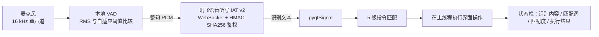

# 医学图像处理综合应用系统

[English](README.md) | **简体中文**


基于 PyQt5 + OpenCV 的桌面端医学影像处理与分析工具。支持普通图像和 **DICOM** 影像，窗宽窗位可交互调节；内置 **10 种处理流程**，覆盖去噪、边缘检测、纹理、分割和伪彩色，拖动参数滑块时结果实时刷新。所有处理都可以只作用于 **ROI 感兴趣区域**。系统还能计算图像质量指标和 **GLCM** 纹理特征，生成结构化分析报告，把整个文件夹批量处理成结果图和 **CSV** 指标表，并支持**中文语音口令**免鼠标操作：先用本地 VAD 检测说话，再调用讯飞流式语音听写识别。


## 亮点

* **医学影像读写**：DICOM 像素先经 `RescaleSlope` / `RescaleIntercept` 换算为 HU 值，再按文件头的窗宽窗位映射显示；两个滑块可实时调窗。只使用技术性标签，不访问患者字段。
* **针对医学图像调优的算法**：所有算子都先做 CLAHE 对比度增强；边缘阈值取当前图像梯度分布的百分位，同一个滑块在 X 光、CT、MRI、超声上都能稳定工作。
* **手写二维卡尔曼滤波**：沿行、再沿列做前向 + 反向一维卡尔曼递推，与原图融合后再做保边双边滤波。
* **两种互补的纹理描述**：NumPy 向量化实现的 8 邻域 LBP，加上 NumPy 手写的 4 方向、32 灰度级 GLCM，不依赖 scikit-image。
* **全面支持 ROI**：设置 ROI 后，处理、对比、直方图、质量指标、GLCM 都只针对该区域。
* **报告与批量导出**：一键生成分析报告，可保存为 `.txt`；批量模式导出“7 种算法 × N 张图像”的结果图，以及 Excel 可直接打开的 UTF-8 CSV。
* **能容忍识别错误的语音控制**：本地 VAD 检测说话、讯飞完成识别，识别文本再经过 5 级指令匹配：参数数值、近音规则、子串匹配、`difflib` 模糊匹配、发音线索兜底。共覆盖 34 个指令。
* **流畅的 Qt 界面**：滑块重处理带防抖，图像显示区尺寸固定，文件读写支持中文路径，语音线程只通过 Qt 信号与界面通信。

## 目录

1. [快速开始](#快速开始)
2. [界面说明](#界面说明)
3. [图像读取与 DICOM](#图像读取与-dicom)
4. [处理算法](#处理算法)
5. [ROI 感兴趣区域](#roi-感兴趣区域)
6. [定量分析](#定量分析)
7. [可视化对比工具](#可视化对比工具)
8. [自动分析报告](#自动分析报告)
9. [批量处理与 CSV 导出](#批量处理与-csv-导出)
10. [语音控制](#语音控制)
11. [工程实现细节](#工程实现细节)
12. [性能](#性能)
13. [代码结构](#代码结构)

## 快速开始

```bash
git clone https://github.com/Brian61-liu/medical-image-processing-system.git
cd medical-image-processing-system
pip install -r requirements.txt
python medical_image_system.py
```

[`images/`](images/) 中附带两个合成样例：

| 文件 | 说明 |
|---|---|
| `shepp_logan_phantom.png` | Shepp-Logan 头部体模，512 × 512，叠加轻微高斯噪声 |
| `phantom_ct.dcm` | 同一体模的 16 位 CT DICOM，数值单位为 HU：空气 −1000、脑脊液 10、脑组织 40、骨 1000；`RescaleIntercept` 为 −1024，默认窗为 400 / 40 |

点击 **选择文件夹** 选中 `images/`，或开启语音后说“打开默认文件夹”。用 **上一张 / 下一张** 在两个样例间切换，然后点击任意算法按钮。

`pydicom` 只在打开 `.dcm` 时需要；`websocket-client`、`sounddevice` 只在使用语音时需要。缺少其中任何一个，其余功能照常可用。

## 界面说明


| 区域 | 控件 |
|---|---|
| 文件栏 | 选择原图像 · 打开DICOM · 选择文件夹 · 上一张 / 下一张 · 计数 `n / N` · 当前路径 |
| 图像区 | 左侧为原图，并绘制 ROI 框；右侧为处理结果；两个显示框尺寸固定 |
| 算法按钮 | 卡尔曼滤波 · Roberts · Sobel · LBP · Canny · Otsu分割+形态学轮廓 · 伪彩色增强 |
| 参数调节 | 所有算法共用一个 1–100 滑块，停止拖动 120 ms 后自动刷新；另有“重新处理”按钮 |
| DICOM 窗宽窗位 | 窗宽、窗位两个滑块，仅在打开 DICOM 时启用 |
| 语音控制 | 开启 / 关闭语音、指令帮助、实时状态栏 |
| 工具 | 一键对比 · 选择ROI · 清除ROI · LBP直方图 · 灰度直方图对比 |
| 组合流程 | 一键生成分析报告 · 卡尔曼+Sobel · 卡尔曼+Roberts · 卡尔曼+LBP |
| 分析 | ROI定量分析 · 图像质量评价 · GLCM纹理特征 · 批量处理+CSV导出 |
| 底栏 | 打开大图 · 保存结果 · 信息栏（文件、类型、尺寸、算法、参数、ROI、处理耗时、保存状态） |

## 图像读取与 DICOM

* **支持格式**：`.png .jpg .jpeg .bmp .tif .tiff .dcm`。打开文件夹时会扫描以上所有格式并按文件名排序，翻到首尾后循环。
* **中文路径**：读图用 `np.fromfile` + `cv2.imdecode`，写图用 `cv2.imencode` + `tofile`，避开 `cv2.imread` 在 Windows 非 ASCII 路径下读取失败的问题。
* **DICOM 处理流程**：
  1. 用 `pydicom.dcmread` 读取文件，像素数组转为浮点；
  2. 按 `raw × RescaleSlope + RescaleIntercept` 换算成模态值（CT 即 HU）；
  3. 从文件头读取 `WindowCenter` / `WindowWidth`，多值标签取第一个；标签缺失时，窗位取中位数，窗宽取 P99 − P1；
  4. 把 `[WL − WW/2, WL + WW/2]` 线性映射到 `[0, 255]` 并截断；
  5. 滑块范围按该图自身的最小 / 最大值设置；拖动滑块会对原始 HU 数据重新调窗，并清空过期的处理结果。
* **隐私**：只读取 Modality、Rows / Columns、PixelSpacing，不访问、也不显示任何患者标签。


## 处理算法


每个算法的输入都是灰度图和滑块值 `v ∈ [1, 100]`。

| 算法 | 处理流程 | 滑块控制什么 |
|---|---|---|
| **卡尔曼滤波** | P0.5–P99.5 百分位拉伸 → 对每一**行**、再对每一**列**做前向 + 反向一维卡尔曼 → 与原图融合 → 双边滤波（d = 5） | 平滑强度：`v` 越大，测量噪声 R 越大、过程噪声 Q 越小、融合权重越高 |
| **Roberts** | CLAHE（clip 1.8）→ 3 × 3 中值滤波 → 2 × 2 交叉模板 `[[1,0],[0,-1]]`、`[[0,1],[-1,0]]` → 梯度幅值 → P2–P98.5 拉伸 → 自适应阈值 → 2 × 2 开运算 | 阈值百分位：在非零边缘强度的 P62 到 P94 之间 |
| **Sobel** | CLAHE（2.0）→ 3 × 3 高斯（σ 0.8）→ Sobel x / y（k = 3）→ 幅值 → P1–P99 拉伸 → 自适应阈值 → 3 × 3 闭运算 | 阈值百分位：P58 到 P92 |
| **Canny** | CLAHE → 5 × 5 高斯（σ 1）→ Canny（L2 梯度），双阈值以中位数 `m` 为中心取 `m(1 ± s)` | 阈值区间宽度 `s = 0.45 + 0.85·v/100`，越大只保留越强的边缘 |
| **LBP** | CLAHE（1.6）→ 3 × 3 中值 → 8 邻域编码（顺时针位序）→ 直方图均衡 → 与 7 × 7 局部标准差图按 0.78 / 0.22 融合 | 原始 LBP 码与均衡化 LBP 码的混合比例 |
| **Otsu + 形态学** | CLAHE → 5 × 5 高斯 → Otsu 阈值（前景超过 60 % 时自动反转）→ 椭圆核开运算、再闭运算 → 外轮廓（面积 ≥ 图像的 0.04 %）→ 22 % 透明度绿色掩膜 + 红色轮廓 | 核大小 3 / 5 / 7，以及闭运算次数 |
| **伪彩色增强** | CLAHE（1.8）→ OpenCV 色彩映射 | `v < 34` 用 BONE，`v < 67` 用 JET，其余用 HOT |
| **卡尔曼 → Sobel / Roberts / LBP** | 卡尔曼输出作为第二个算子的输入 | 同时作用于两级 |

**卡尔曼滤波细节**：把每一行或每一列像素当作一维信号，采用常值状态模型：

```
预测：x̂⁻ = x̂,           P⁻ = P + Q
更新：K  = P⁻ / (P⁻ + R)
      x̂  = x̂⁻ + K (z − x̂⁻),   P = (1 − K) P⁻
```

其中 `Q = 1e-5 + 2e-5·(101 − v)/100`，`R = 0.004 + 0.10·v/100`。前向、反向各递推一次后取平均，消除单向滤波带来的拖影；先处理行、再处理列。结果按 `α = 0.45 + 0.45·v/100` 与拉伸后的原图融合，最后做 `σ_color = 20 + 0.4v` 的双边滤波。

**自适应边缘阈值**：固定阈值在偏暗的 MRI 和偏亮的 X 光上表现差别很大。这里的阈值取当前图像自身非零梯度幅值的某个百分位，滑块决定取哪个百分位；并使用 `THRESH_TOZERO`，保留下来的边缘不丢失强度信息。

## ROI 感兴趣区域

* **选择 ROI**：弹出 OpenCV 窗口，拖动鼠标框选，Enter / Space 确认，Esc 取消。
* **中心 ROI**：不用鼠标，直接取图像中央 50 % × 50 % 的区域，可通过语音指令调用。
* 设置 ROI 后，算法**只处理裁剪出的区域**，结果贴回灰度原图并加框：灰度结果用白框，彩色结果（伪彩色、Otsu）用黄框。
* 一键对比、LBP 直方图、质量评价、GLCM 在存在 ROI 时都只针对 ROI；**ROI 定量分析** 会同时给出 ROI 的位置尺寸和下列全部指标。


## 定量分析

| 指标 | 定义 |
|---|---|
| 平均灰度 | `mean(I)` |
| 灰度标准差 / 对比度 | `std(I)` |
| 信息熵 | 256 级直方图的香农熵 `−Σ p log₂ p` |
| 清晰度 | 拉普拉斯算子响应的方差 |
| 边缘像素比例 | `Canny(60, 160)` 判定为边缘的像素占比 |
| 纹理复杂度 | 7 × 7 局部标准差的均值除以 255 |

**GLCM**：灰度量化为 32 级；在距离 1、**4 个方向（0°、45°、90°、135°）** 上统计共现次数，对称累加后归一化为 `p(i, j)`，用 `np.add.at` 向量化计算。

| 特征 | 公式 |
|---|---|
| 对比度 Contrast | `Σ (i − j)² p` |
| 同质性 Homogeneity | `Σ p / (1 + │i − j│)` |
| 能量 Energy | `Σ p²` |
| 相关性 Correlation | `Σ (i − μᵢ)(j − μⱼ) p / (σᵢ σⱼ)` |
| 熵 Entropy | `−Σ p log₂ p` |

`phantom_ct.dcm` 中心 ROI（窗宽 160 / 窗位 40）的实际输出：

```
ROI感兴趣区域定量分析                     ROI-GLCM纹理特征
平均灰度：116.92                          对比度 Contrast：3.55
灰度标准差：29.17                         同质性 Homogeneity：0.53
信息熵：5.95                              能量 Energy：0.02
清晰度：1990.08                           相关性 Correlation：0.87
边缘像素比例：0.0245                      熵 Entropy：6.22
纹理复杂度：0.0425                        灰度级 Levels：32
ROI面积/像素：65536
```

**图像质量评价**：对原图（或 ROI）和当前处理结果分别计算上述指标并并列展示，附简要解读。例如做伪彩色增强后，标准差从 29.2 升到 86.2，边缘比例从 0.025 升到 0.105。

## 可视化对比工具

| 一键对比 | LBP 纹理直方图 |
|---|---|
|  |  |

* **一键对比**：原图与卡尔曼、Roberts、Sobel、LBP 的结果并排显示，均使用当前参数和 ROI。
* **LBP 直方图**：画出 256 种编码的分布（用 OpenCV 绘制，不依赖 matplotlib），并给出均值、标准差、取值范围和纹理复杂度。
* **灰度直方图对比**：处理前后的 256 级灰度直方图并排显示，附均值与标准差。
* **放大查看**：在可调整大小的窗口中并排查看原图和结果。


## 自动分析报告

**一键生成实验分析报告** 会根据当前图像和处理结果生成结构化文本报告，可保存为 UTF-8 `.txt`：

* **报告头**：生成时间、文件名、尺寸、算法、参数、ROI、处理耗时、保存状态；若为 DICOM，还包括当前窗宽窗位
* **一、算法作用说明**：当前处理流程的原理
* **二 / 三、统计指标**：原图与处理结果的均值、标准差、最小值、最大值、信息熵、拉普拉斯清晰度
* **四、结果分析**：按算法给出相应结论，例如边缘算子给出边缘比例、LBP 给出纹理复杂度、卡尔曼说明平滑效果
* **五、免责声明**


## 批量处理与 CSV 导出

**批量处理+CSV导出** 会用当前参数值，对已加载文件夹中的每张图像运行全部 7 种单级算法：

```
<导出目录>/
├── kalman/        <文件名>_kalman.png
├── roberts/       <文件名>_roberts.png
├── sobel/         <文件名>_sobel.png
├── canny/         <文件名>_canny.png
├── lbp/           <文件名>_lbp.png
├── segment/       <文件名>_segment.png
├── pseudo_color/  <文件名>_pseudo_color.png
└── analysis_report.csv
```

* 长边超过 1200 px 的图像会先等比缩小，保证批量处理速度。
* CSV 中每张图像的每种算法各占一行，字段：文件名、算法、状态、原图均值 / 标准差 / 信息熵、处理后均值 / 标准差 / 信息熵 / 清晰度 / 边缘比例、保存路径。
* CSV 以 `utf-8-sig` 编码写出，Excel 能正确显示中文表头；单张图像出错只记在对应行，不会中断整批；进度显示在信息栏。

附带体模的实际结果节选：

| 算法 | 原图信息熵 | 处理后信息熵 | 处理后清晰度 | 边缘比例 |
|---|---|---|---|---|
| 卡尔曼滤波 | 5.84 | 5.77 | 22.8 | 0.011 |
| Roberts | 5.84 | 0.90 | 2 485.7 | 0.048 |
| Sobel | 5.84 | 2.81 | 1 423.0 | 0.099 |
| Canny | 5.84 | 0.68 | 117 432.6 | 0.184 |
| LBP | 5.84 | 6.99 | 55 358.0 | 0.383 |
| Otsu + 形态学 | 5.84 | 6.76 | 2 569.3 | 0.025 |
| 伪彩色增强 | 5.84 | 6.38 | 8 486.1 | 0.243 |

## 语音控制



**语音采集在本地进行**，检测到开始说话后才上传音频：

| 环节 | 设定 |
|---|---|
| 噪声校准 | 启动时采集 1 秒环境音，阈值取 `clip(3·RMS + 120, 300, 3000)` |
| 说话检测 | 每块 1024 采样点（约 64 ms）的 RMS 达到阈值即判定开始说话；保留 0.45 秒预录缓冲，避免丢掉第一个字 |
| 结束判定 | 静音持续 1.2 秒，或达到 12 秒上限 |
| 噪声过滤 | 短于 0.2 秒的声音直接丢弃 |
| 上传 | 按 1280 字节（40 ms）分帧，status 依次为 0 / 1 / 2；普通话，`vad_eos` 2000 ms；边发送边读取中间结果 |

**指令匹配** 专门针对容易识别错的短口令：

0. **参数数值**：“参数80”直接把滑块设为 80，“参数增大 / 减小”每次调整 ±10。
1. **近音规则**：常见误识别直接映射到指令，例如“宜都一度”（实际说的是“梯度”）映射到 Sobel，“萝卜”映射到 Roberts。
2. **子串匹配**：与关键词库做包含匹配，能处理“请执行卡尔曼滤波”这类长句。
3. **模糊匹配**：`difflib.SequenceMatcher` 相似度不低于 0.58 即可。
4. **低分兜底**：最接近的关键词属于 Sobel、Roberts 或 LBP，且文本中含有对应的发音线索时，仍然执行该指令。

支持的指令（共 34 个，每个都有多种说法）：

| 类别 | 示例口令 |
|---|---|
| 文件 | 打开默认文件夹、选择图像、选择文件夹、上一张、下一张、保存 |
| 算法 | 滤波、罗伯茨、索贝尔 / 梯度、纹理 / LBP、坎尼、大津分割、伪彩色 |
| 组合流程 | 组合索贝尔、组合罗伯茨、组合纹理 |
| 分析 | ROI分析、质量评价、GLCM、灰度直方图、生成报告、批量处理 |
| 显示 | 一键对比、直方图、放大 / 预览 |
| ROI | 中心ROI、手动ROI、清除ROI |
| 参数 | 参数增大、参数减小、参数设为50 |
| 系统 | 帮助、关闭语音、退出程序 |

配置方法：在[讯飞开放平台](https://www.xfyun.cn/)创建应用并开通“语音听写”，然后执行：

```bat
setx XFYUN_APPID "你的APPID"
setx XFYUN_API_KEY "你的APIKey"
setx XFYUN_API_SECRET "你的APISecret"
```

凭据只从环境变量读取。

## 工程实现细节

* **防抖实时预览**：滑块每次变化都会重启一个 120 ms 的单次 `QTimer`，一次拖动只触发一次计算，而不是几十次。
* **布局稳定**：`StableImageLabel` 固定了尺寸提示，加载不同尺寸的图像时窗口不会被撑大，布局也不会偏移。
* **线程安全**：语音线程是守护线程，从不直接操作控件；它只发出 `pyqtSignal`，指令匹配和界面操作都在主线程执行。关闭窗口时在 `closeEvent` 中停止该线程。
* **可选依赖优雅降级**：`pydicom`、`websocket-client`、`sounddevice` 都放在保护性导入里；缺少时弹出安装提示，程序不会崩溃。
* **稳健的归一化**：百分位拉伸避免高亮骨骼和暗背景压缩软组织的对比度；遇到常数图返回全零图，不会除零。
* 主窗口启动后自动在可用屏幕区域（不含任务栏）居中。

## 性能

在 512 × 512 样例上运行 5 次取中位数（笔记本 CPU）：

| 操作 | 耗时 |
|---|---|
| 伪彩色、Canny、Otsu + 形态学 | 约 17–24 ms |
| Sobel、Roberts、LBP | 约 42–50 ms |
| 质量指标 | 约 20 ms |
| GLCM（32 级、4 方向） | 约 0.4 s |
| 卡尔曼滤波（纯 Python 递推，2 × 512 条线、正反两个方向） | 约 0.5 s |

卡尔曼滤波的递推是顺序执行的，因此最慢；下一步可以用 NumPy 在多条线之间向量化来加速。

## 代码结构

`medical_image_system.py` 是约 3500 行的单文件自包含模块：

| 部分 | 内容 |
|---|---|
| 读写 | `read_image_unicode`、`save_image_unicode`、`read_medical_image`、`dicom_pixels_to_uint8`、`get_image_files_from_folder` |
| 预处理 | `percentile_stretch`、`medical_contrast_enhance`（CLAHE）、`adaptive_edge_threshold`、`normalize_to_uint8` |
| 算法 | `kalman_filter_image`、`roberts_operator`、`sobel_gradient`、`canny_edge_detection`、`lbp_local_binary_pattern`、`otsu_morphology_contour`、`pseudo_color_enhancement` |
| 指标 | `calculate_entropy`、`calculate_sharpness`、`calculate_edge_ratio`、`calculate_image_quality_metrics`、`calculate_glcm_features` |
| 调度 | `process_with_optional_roi`：选择处理流程，并负责 ROI 的裁剪与回贴 |
| 对话框 | `ImagePreviewDialog`、`CompareDialog`、`LbpHistogramDialog`、`GrayHistogramCompareDialog`、`AnalysisReportDialog` |
| 语音 | `XfyunVoiceRecognitionWorker`：VAD、请求签名、流式上传、结果解析 |
| 主窗口 | `MedicalImageProcessingSystem`：界面、ROI、DICOM 调窗、语音指令匹配、报告、批量处理、保存 |

处理函数是纯 NumPy / OpenCV 代码，不启动界面也能直接调用（模块顶部导入了 PyQt5，因此仍需安装）：

```python
import cv2
from medical_image_system import process_with_optional_roi, calculate_glcm_features

img = cv2.imread("images/shepp_logan_phantom.png", cv2.IMREAD_GRAYSCALE)
edges = process_with_optional_roi(img, None, "Sobel梯度", 50)
print(calculate_glcm_features(img))
```

## 说明

* 两个附带图像都是计算机合成的体模，不包含任何患者数据；使用真实 DICOM 前请先脱敏。
* 所有指标仅用于算法效果对比，**不作为医学诊断依据**。

## 许可证

[MIT](LICENSE)
